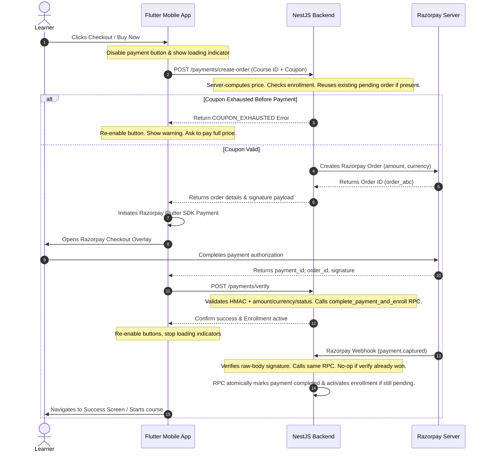

# Comprehensive Implementation Plan: Courses, Coupons, & Razorpay Payment Integration

This implementation plan details the full blueprint for linking the Flutter frontend with the NestJS backend and implementing a secure payment checkout using **Razorpay** and **Coupons**.

---

## Phase 1: Database Schema Migrations

We will create new SQL migration files in Supabase to define the necessary tables, including Row Level Security (RLS) policies.

### 1. New Tables Schema (`supabase/migrations/`)
* **`coupons`**:
  * `id` (UUID, Primary Key)
  * `code` (TEXT, Unique, Index)
  * `discount_type` (TEXT: `'percentage' | 'fixed'`)
  * `discount_value` (NUMERIC)
  * `max_uses` (INTEGER, Nullable)
  * `uses_count` (INTEGER, Default 0)
  * `min_purchase_amount` (NUMERIC, Default 0.00)
  * `starts_at` (TIMESTAMPTZ)
  * `expires_at` (TIMESTAMPTZ)
  * `is_active` (BOOLEAN, Default True)
  * `created_at` (TIMESTAMPTZ, Default NOW())
* **`enrollments`**:
  * `id` (UUID, Primary Key)
  * `user_id` (UUID, References `auth.users`)
  * `course_id` (UUID, References `courses`)
  * `status` (TEXT: `'active' | 'expired' | 'refunded'`)
  * `validity_end_at` (TIMESTAMPTZ, Nullable)
  * `progress_percent` (INTEGER, Default 0)
  * `enrolled_at` (TIMESTAMPTZ, Default NOW())
  * `created_at` / `updated_at`
  * **Constraint**: UNIQUE index on `(user_id, course_id)` where status is `'active'` to prevent duplicate active enrollments.
* **`payments`**:
  * `id` (UUID, Primary Key)
  * `user_id` (UUID, References `auth.users`)
  * `course_id` (UUID, References `courses`)
  * `coupon_id` (UUID, References `coupons`, Nullable)
  * `base_amount` (NUMERIC(10,2))
  * `discount_amount` (NUMERIC(10,2), Default 0.00)
  * `amount_paid` (NUMERIC(10,2))
  * `amount_subunits` (INTEGER, Razorpay amount in smallest currency unit)
  * `currency` (TEXT, Default `'INR'`)
  * `razorpay_order_id` (TEXT, Unique, Index)
  * `razorpay_payment_id` (TEXT, Nullable)
  * `razorpay_signature` (TEXT, Nullable)
  * `status` (TEXT: `'pending' | 'completed' | 'failed' | 'expired' | 'refunded'`)
  * `expires_at` (TIMESTAMPTZ, for pending order reuse/expiry)
  * `created_at` (TIMESTAMPTZ, Default NOW())
  * `updated_at` (TIMESTAMPTZ, Default NOW())
  * **Indexes/Constraints**:
    * Unique index on `razorpay_order_id`.
    * Unique partial index on `razorpay_payment_id` where not null.
    * Partial unique index to prevent multiple live checkout attempts for the same user/course while status is `'pending'` and `expires_at > now()` cannot be expressed directly with `now()` in an immutable index, so enforce this by either:
      * reusing an existing non-expired pending payment row in `create-order`, or
      * expiring old pending rows before creating a new one inside a DB function.
* **`course_resources`**:
  * `id` (UUID, Primary Key)
  * `course_id` (UUID, References `courses`)
  * `title` (TEXT)
  * `file_url` (TEXT)
  * `file_size` (TEXT)
  * `file_type` (TEXT)
  * `created_at` (TIMESTAMPTZ)
* **`webhook_logs`** (For Audit & Debugging):
  * `id` (UUID, Primary Key)
  * `razorpay_event_id` (TEXT, Unique, Nullable)
  * `razorpay_order_id` (TEXT, Nullable)
  * `razorpay_payment_id` (TEXT, Nullable)
  * `event_type` (TEXT)
  * `payload` (JSONB)
  * `signature_verified` (BOOLEAN, Default False)
  * `processed_at` (TIMESTAMPTZ, Nullable)
  * `created_at` (TIMESTAMPTZ, Default NOW())

### 2. Row Level Security (RLS) & Server Role Access
The NestJS backend will communicate with the database using the **`service_role` key**, bypassing RLS for all write operations. Regular clients will connect via the `anon/authenticated` keys where RLS is fully enforced.
* **`coupons`**:
  * SELECT: Allow authenticated users to search/read active coupons.
  * INSERT/UPDATE/DELETE: Restricted to admin/superadmin roles.
* **`enrollments`**:
  * SELECT: Users can only read their own enrollments (`user_id = auth.uid()`).
  * INSERT/UPDATE/DELETE: Bypassed by backend server via `service_role` client. No write policies granted to regular users.
* **`payments`**:
  * SELECT: Users can only read their own payment logs (`user_id = auth.uid()`).
  * INSERT/UPDATE/DELETE: Bypassed by backend server via `service_role` client. No write policies granted to regular users.
* **`course_resources`**:
  * SELECT: Restricted to authenticated users who have an active enrollment in the related course.

### 3. Native Postgres RPC for Atomic Fulfillment
Because the backend currently uses `@supabase/supabase-js` as the primary data layer, payment fulfillment must not rely on app-side multi-statement transactions. We will create a PL/pgSQL function in a Supabase migration and call it from NestJS with `supabase.rpc(...)`.

* **Function**: `complete_payment_and_enroll(p_order_id text, p_payment_id text, p_signature text)`
* **Called by**:
  * `POST /api/v1/payments/verify`
  * `POST /api/v1/payments/webhook`
* **Why this approach**:
  * Keeps the backend on `supabase-js` without adding a second `pg` connection pool.
  * Keeps `WHERE status = 'pending'` payment idempotency and `WHERE uses_count < max_uses` coupon guards inside native SQL.
  * Lets `/verify` and `/webhook` share one database-defined state transition so whichever path hits first wins.
* **Responsibilities inside the function**:
  1. Lock the matching payment row by `razorpay_order_id` with `FOR UPDATE`.
  2. If the payment is already `'completed'`, return a success result without creating a second enrollment or incrementing coupon usage again.
  3. Reject if the payment is not `'pending'`, has expired, or the provided Razorpay payment id conflicts with another completed payment.
  4. Update the payment row from `'pending'` to `'completed'`, storing `razorpay_payment_id`, `razorpay_signature`, and `updated_at`.
  5. If a coupon was applied, atomically increment `coupons.uses_count`:
     ```sql
     UPDATE public.coupons
     SET uses_count = uses_count + 1
     WHERE id = v_payment.coupon_id
       AND (max_uses IS NULL OR uses_count < max_uses);
     ```
  6. If strict coupon limits are required, raise an exception when the coupon update affects zero rows. If business policy says paid users must always be fulfilled, log the oversubscription and continue. The implementation must choose one policy explicitly before release.
  7. Upsert the enrollment as `'active'`, calculating `validity_end_at` from `courses.validity_days` when present.
  8. Return a structured result such as `{ "status": "completed", "enrollmentId": "...", "alreadyProcessed": false }`.

The NestJS code still verifies Razorpay signatures and payment/order details before calling this RPC. The RPC is the atomic database state transition, not a replacement for gateway validation.

---

## Phase 2: Backend API Routes (NestJS)

### 1. Courses Module (`/api/v1/courses`)
* **`GET /api/v1/courses`**: Fetch lists of courses.
* **`GET /api/v1/courses/:idOrSlug`**: Fetch course details with sections, lessons, and enrollment state.
  * Existing course endpoints already exist; implementation should extend the current repository/service to include sections, lessons, and enrollment state.
  * For non-enrolled users, only return preview-safe lesson data. Do not expose paid `video_url`, resource URLs, or downloadable files unless the user has an active enrollment.

### 2. Coupons Module (`/api/v1/coupons`)
* **`POST /api/v1/coupons/validate`**:
  * **Request Body**: `{ "code": "SAVE20", "courseId": "uuid" }`
  * **Response**: `{ "valid": true, "discountAmount": 150.00, "finalPrice": 649.00 }`

### 3. Payments Module (`/api/v1/payments`)
* **`POST /api/v1/payments/create-order`**:
  * **Pricing Trust Boundary**: Server-computes final checkout price using DB definitions.
  * Store money in both human-readable decimal columns and Razorpay integer subunits. The integer `amount_subunits` is the value sent to Razorpay and later verified.
  * **Pre-Payment Coupon Exhaustion Guard**:
    1. Checks if an active enrollment already exists for `(user_id, course_id)`. If yes, returns an error.
    2. Checks for an existing non-expired pending payment for the same `(user_id, course_id)` and reuses it instead of creating another Razorpay order.
    3. If a coupon code is supplied, re-runs coupon validation: Checks `is_active`, `starts_at`, `expires_at`, `min_purchase_amount`, and checks if `uses_count < max_uses`.
    4. If the coupon is exhausted between validation and order clicks, returns a `COUPON_EXHAUSTED` error. The client displays the error and lets the user choose to buy at full price or cancel. No Razorpay order is generated.
  * **Processing**: Generates a Razorpay Order, inserts a `'pending'` payment row with `expires_at`, and returns order details.
  * **Duplicate Charge Protection**: The frontend disables the pay button, but the backend remains authoritative. Repeated taps, app retries, or network retries must return the existing pending order or a clear conflict instead of creating parallel payable orders.
* **`POST /api/v1/payments/verify`**:
  * **Request Body**: `{ "razorpayOrderId": "order_xyz", "razorpayPaymentId": "pay_xyz", "razorpaySignature": "sig_xyz" }`
  * **Processing**:
    1. Verify HMAC signature using Razorpay Key Secret.
    2. Fetch/verify Razorpay order or payment details server-side where needed, confirming:
       * order id matches the pending payment row,
       * amount matches `payments.amount_subunits`,
       * currency matches `payments.currency`,
       * payment status is captured/authorized according to the chosen Razorpay capture mode.
    3. Call `supabase.rpc('complete_payment_and_enroll', { p_order_id, p_payment_id, p_signature })`.
    4. Return the RPC result. If the RPC reports `alreadyProcessed`, return success idempotently.
* **`POST /api/v1/payments/webhook`**:
  * Configure NestJS raw body capture for this route because Razorpay webhook verification requires the exact raw request body, not a reserialized JSON object.
  * Verify webhook signature using the Razorpay webhook secret before trusting the event.
  * Log `razorpay_event_id`, order id, payment id, payload, and signature verification status in `webhook_logs`.
  * For fulfillment events such as `payment.captured`, call the same `complete_payment_and_enroll` RPC used by `/verify`.
  * Webhook idempotency is enforced by:
    * unique `webhook_logs.razorpay_event_id`, and
    * the RPC's locked `payments.status = 'pending'` transition.

---

## Phase 3: Razorpay Checkout Flow & Duplicate Protection



---

## Phase 4: Flutter Frontend Integration

### 1. Router & Models
* **Router**: Update `app_router.dart` so `/course` accepts query/path parameters (e.g. `/course?id=uuid`).
* **Models**: Update `course.dart` to support nested sections and lessons structure.
* **Payments Dependency**: Add and configure the Razorpay Flutter SDK package. Store only the public Razorpay key id in the app; never ship Razorpay key secrets in Flutter.

### 2. Connect Store Screen
* Fetch categories and popular courses from `GET /api/v1/courses` instead of using static lists.
* Navigate to `/course?id=${course.id}` on click.

### 3. Connect Details Screen
* Fetch detailed course info on page load using `GET /api/v1/courses/:idOrSlug`.
* Show "Buy Course" button if enrollment check is false. Show "Resume Learning" if true.
* Display real sections and lessons under the tabs dynamically.

### 4. Connect Cart & Coupon Checkout
* **Coupon Field**: Add a Coupon/Promo Code text input field inside the Checkout bottom sheet/Cart screen.
* **Validation Action**: When the coupon is entered and "Apply" is clicked:
  1. Call `POST /api/v1/coupons/validate`.
  2. If valid, show green success text and reduce the checkout total amount.
  3. If invalid, display a red error message.
* **Payment Action**: Trigger `/payments/create-order` with the loading overlay, launch Razorpay Checkout, and direct the user to the success screen on verification. Handle `COUPON_EXHAUSTED` responses gracefully.
* **Verification Fallback**: If checkout succeeds but `/payments/verify` fails due to network/app interruption, show a pending confirmation state and refresh enrollment/payment status. The webhook should complete fulfillment independently.
* **Retry Behavior**: Repeated taps or retries should call `create-order` again and accept the reused pending order response instead of creating a new payment attempt.

---

## Phase 5: Testing & Release Checks

* **Database/RPC Tests**:
  * Calling `complete_payment_and_enroll` twice for the same order returns success once and `alreadyProcessed` afterward.
  * Coupon usage increments exactly once for normal idempotent verify/webhook races.
  * Expired, failed, refunded, or non-pending payments cannot create enrollments.
  * Duplicate active enrollments are prevented by constraints.
* **Backend Tests**:
  * `create-order` computes amount server-side and ignores client-supplied prices.
  * Existing pending orders are reused.
  * Razorpay signature, amount, currency, and payment status mismatches are rejected.
  * Webhook signature verification uses the raw body and rejects tampered payloads.
* **Frontend Checks**:
  * Payment button disables during order creation and checkout launch.
  * Coupon success/error/exhausted states are clear.
  * Network failure after Razorpay success lands on a pending confirmation state, then resolves after webhook fulfillment.

---

## Phase 6: Admin Panel Sections (Deferred - Requires Explicit Confirmation)

> [!IMPORTANT]
> The implementation of these admin features is placed here as a final step. I will ask you for permission before writing any code in `mbt-admin` for these modules.

* **Coupons Section**:
  * List created coupons, usage statistics, and active status.
  * Form to create new coupons with code, discount values, minimum spends, and expiration dates.
* **Orders & Payments Section**:
  * View payment records, transaction statuses (pending, completed, failed), associated user profiles, and applied coupons.
  * Audit logs of Razorpay transactions.
